# PaperERP Enterprise — Architecture Correction, MVP Blueprint & 3-Person Team Execution Plan

> **Document Classification**: Master Engineering Specification & Team Execution Blueprint  
> **Target System**: PaperERP Enterprise (Industrial Paper Manufacturing ERP)  
> **Team Size**: 3 Remote Senior Engineers (Dev A: Foundation/Security, Dev B: Domain/Database, Dev C: Frontend/UX)  
> **Collaboration Platform**: GitHub (Private Repository, Branch Protection, PRs, Projects, GitHub Actions CI)  
> **Author**: Principal Enterprise Software Architect, Manufacturing Domain Analyst, Application Security & DevOps Lead  

---

## A. Executive Audit: Baseline Plan Critical Analysis

The baseline plan established a solid catalog of long-term paper mill capabilities, but suffered from classic enterprise over-scoping that creates severe delivery risk for a 3-person remote team. Below is a critical engineering audit of that baseline:

### 1. Strengths of the Baseline Plan
* **Individual Roll Tracking as the Atomic Unit**: Correctly identifying that a paper mill cannot function with coarse aggregate inventory (e.g., "50 tons of Fluting in stock"). Each physical roll must have its own serial number, weight, GSM, width, and quality state.
* **Refusal to Hardcode Factory Rules**: Explicitly preventing fabricated recipes, chemical formulas, and unverified machine setups before engaging an actual pilot factory.
* **Auditability & Traceability First**: Requiring immutable history for quality decisions, price overrides, and roll genealogy.

### 2. Critical Weaknesses & Over-Engineering Pitfalls
* **Premature Scope Sprawl**: Incorporating full General Ledger accounting, HR/payroll statutory deductions, computerized maintenance (CMMS), machine PLC telemetry, and Windows desktop wrapper packaging into the initial plan. Attempting this simultaneously with 3 developers guarantees failure, partial implementations, and missed deadlines.
* **Unclear Multi-Tenancy Strategy**: Treating multi-plant and multi-factory requirements vaguely without specifying the database isolation boundary (Shared DB with tenant ID vs Schema-per-tenant vs DB-per-tenant).
* **Mutable Stock Balance vs Immutable Movement Ledger**: The baseline mentioned both "inventory balances" and "movement ledger" without cementing the authoritative source of truth. In manufacturing ERPs, mutable balance columns cause silent race conditions and untraceable drift.
* **Under-Specified Slitting Mechanics**: The physical transformation where 1 parent Jumbo Reel (Mother Roll) is slit into 3–12 customer slit rolls (child rolls) with edge trim waste is the core operational pivot of a paper mill. The previous plan lacked explicit transactional mechanics for this parent-child decomposition.

### 3. Top Project Risks & Mitigations
| Risk ID | Severity | Impact Description | Recommended Mitigation | Blocking? |
| :--- | :--- | :--- | :--- | :--- |
| **RSK-01** | **CRITICAL** | Trying to build Accounting, HR, Maintenance, and Production simultaneously with 3 devs. | **Narrow the MVP strictly** to: Auth/Tenant $\rightarrow$ Master Data $\rightarrow$ Inventory Ledger $\rightarrow$ Jumbo Production $\rightarrow$ Slitting $\rightarrow$ Quality Lab $\rightarrow$ Arabic RTL UI. Postpone all other modules. | **YES (Blocks Sprints)** |
| **RSK-02** | **HIGH** | No confirmed pilot factory means machine speeds, trim allowances, and grade specs are unknown. | Put all tolerances, paper grades, GSM ranges, and slitting limits into **configurable database tables**, not hardcoded enums or constants. | **YES (Blocks Schema)** |
| **RSK-03** | **HIGH** | Race conditions during concurrent roll reservations or slitting operations leading to duplicate serials or double-dispatches. | Enforce database-level `UNIQUE` constraints on roll serials, optimistic locking (`@Version`) on parent rolls, and row-level locking (`SELECT ... FOR UPDATE`) during status transitions. | NO (Design requirement) |
| **RSK-04** | **MEDIUM** | Git merge conflicts and blocked PRs among 3 remote developers editing overlapping files. | Establish strict **code ownership boundaries** (Dev A = Platform/Infra, Dev B = Domain/Ledger, Dev C = Frontend) with isolated packages and mocked API contracts. | NO (Process requirement) |

---

## B. Change Log: Baseline Plan Realignment

This table details exactly what has been kept, modified, postponed, or removed from the baseline plan:

| Item / Capability | Baseline Plan Status | Corrected Status | Architectural / Business Rationale |
| :--- | :--- | :--- | :--- |
| **Core Roll Traceability** | Included in Phase 4/5 | **KEEP & EXPAND (Core MVP)** | Fundamental competitive advantage and operational requirement of the system. |
| **Parent-Child Slitting** | Mentioned briefly | **EXPAND TO FIRST-CLASS FLOW** | The slitting process (Jumbo $\rightarrow$ Child Rolls + Trim Loss) is the heart of paper mill operations. |
| **Immutable Stock Ledger** | Proposed alongside balances | **KEEP (Authoritative Source of Truth)** | Stock balances must be derived/reconciled views of immutable `inventory_movements`, not a raw mutable integer. |
| **Multi-Tenancy Isolation** | Unspecified | **MODIFY (Shared DB + Tenant ID + RLS)** | Realistic for a 3-person team while enforcing strict tenant security via Hibernate filters and PostgreSQL Row-Level Security. |
| **Arabic-First RTL Frontend** | Proposed | **KEEP & STANDARDIZE** | Essential for factory floor operators in MENA. Built with Tailwind RTL, Cairo font, and accessible components. |
| **General Ledger & Financial Accounting** | Scheduled for Phase 7 | **POSTPONE TO POST-MVP** | Full accounting (double-entry, trial balance, period closing) requires dedicated domain validation and is not needed to prove physical roll traceability. |
| **HR, Shifts & Payroll** | Scheduled for Phase 8 | **POSTPONE TO POST-MVP** | Complex labor laws, shifts, and statutory deductions distract from manufacturing integrity. Operator ID will simply be recorded on roll production. |
| **CMMS Machine Maintenance** | Scheduled for Phase 8 | **POSTPONE TO POST-MVP** | Maintenance work orders and spare parts can be tracked independently later once machine telemetry requirements are clear. |
| **Automated Scale/PLC Telemetry** | Scheduled for Phase 10 | **POSTPONE TO POST-MVP** | Hardware integration requires specific hardware protocols (RS-232, Modbus, OPC-UA). MVP will support manual weight entry with scale validation. |
| **Windows Desktop Wrapper (Tauri)** | Proposed in Section 3.4 | **POSTPONE TO POST-MVP** | Browser-based responsive web app running on factory LAN tablets and PCs is 100% sufficient for MVP deployment. |

---

## C. MVP Scope Definition & Explicit Exclusions

### 1. In-Scope MVP Capabilities (The "Walking Skeleton")
The PaperERP MVP is strictly bounded to the **End-to-End Traceable Roll Lifecycle**:

```
[Master Data: Plants, Grades, UOMs]
               │
               ▼
   [Jumbo Roll Production Logging] ──(Weigh & Tag)──► [Jumbo Roll in WIP Inventory]
               │
               ▼
     [Slitting / Rewinding] ──(Trim Loss Recorded)──► [Child Rolls Created & Serialized]
               │
               ▼
    [Laboratory QC Inspection] ──(GSM, Moisture, Burst)──► [Disposition: RELEASED / QUARANTINE / REJECTED]
               │
               ▼
   [Warehouse Transfer & Dispatch] ──(Locked to RELEASED only)──► [Stock Depleted with Immutable Audit]
```

#### Detailed MVP Capability Matrix:
1. **Multi-Tenant Foundation & Security**: Tenant provisioning, Plant/Mill scoping, User authentication (JWT + HttpOnly cookie), Role-Based Access Control (Admin, Plant Manager, Production Operator, QC Inspector, Warehouse Keeper).
2. **Factory Master Data**: Paper grades (Fluting, Testliner, Kraft, Duplex), GSM basis weight targets & tolerance bands, Width specifications (mm), Units of Measure (kg, metric ton, mm, meter) with strict decimal conversions.
3. **Immutable Inventory Ledger**: Double-entry movement ledger (`inventory_movements`) tracking receipts, slitting consumption, finished roll generation, warehouse bin transfers, and dispatch. Zero mutable stock counters.
4. **Jumbo Roll Management**: Recording Pope Reel output from the paper machine (Jumbo serial, reel weight, machine ID, shift, target GSM, actual width).
5. **Slitting & Roll Decomposition**: Interactive slitting order execution taking a parent Jumbo Roll, defining cut patterns (e.g., $1 \times 2400\text{mm} \rightarrow 2 \times 1000\text{mm} + 1 \times 350\text{mm} + 50\text{mm}$ trim loss), generating unique child roll serials with parent genealogy.
6. **Quality Control (QC) Gate**: Physical lab testing (Actual GSM, Moisture %, Caliper thickness, Burst strength). Disposition decisions (`RELEASED`, `QUARANTINE`, `REJECTED`, `DOWNGRADED`). **Hard barrier**: System mathematically prevents transferring, reserving, or dispatching non-released rolls.
7. **Warehouse Management**: Location tracking (Warehouse $\rightarrow$ Bay $\rightarrow$ Row $\rightarrow$ Stack), barcode/QR serial generation (Code 128 / QR Code SVG), stocktaking verification.
8. **Arabic RTL Operations UI**: High-density, tablet-friendly, keyboard-accessible Arabic RTL interface with clean English toggle.
9. **Automated Verification**: 100% automated test coverage of domain invariants via JUnit 5, Mockito, Testcontainers PostgreSQL, and Vitest.

### 2. Explicit MVP Exclusions
* ❌ Double-entry Chart of Accounts, General Ledger, Balance Sheet, Trial Balance.
* ❌ Payroll, biometric attendance clocks, and employee statutory deductions.
* ❌ Maintenance work orders, spare parts management, and vibration analysis.
* ❌ Procurement 3-way matching and vendor invoice settlement.
* ❌ Direct hardware serial port communication (RS-232 / OPC-UA).
* ❌ Offline-first sync engine (system operates directly on local factory LAN).
* ❌ Tauri/Electron desktop wrapper.

---

## D. Architecture Decision Records (ADRs)

### ADR-001: System Architecture — Modular Monolith
* **Status**: APPROVED
* **Context**: We need high development velocity, strict data consistency across roll slitting and inventory movements, and zero operational overhead for a 3-person remote team.
* **Options Considered**:
  1. *Microservices* (Auth Service, Inventory Service, Production Service, QC Service).
  2. *Single Untyped Monolith* (Django / Rails / Express).
  3. *Modular Monolith in Spring Boot 3* (Strict internal package boundaries, shared transactional database, domain events).
* **Decision**: Adopt a **Modular Monolith** in Spring Boot 3.4.x. Each domain (`identity`, `masterdata`, `inventory`, `production`, `quality`) resides in its own isolated Java package. Cross-module calls are allowed ONLY via exported Java service interfaces or Spring Application Events (`@DomainEvents`). Direct repository-to-repository cross-coupling is prohibited.
* **Consequences**:
  * *Positive*: Single deployment unit (JAR), atomic ACID transactions across roll slitting and ledger entries, simple local debugging, zero distributed network latency or partial failure headaches.
  * *Negative*: Requires architectural discipline to prevent lazy developers from autowiring foreign repositories. Enforced via ArchUnit tests in CI.

---

### ADR-002: Multi-Tenancy Strategy — Partitioned Shared Database with Row-Level Security
* **Status**: APPROVED
* **Context**: PaperERP will serve multiple independent paper factories. A single installation may host one factory group with multiple plants, or a cloud instance serving multiple client companies.
* **Options Considered**:
  1. *Database-per-tenant*: Maximum isolation, but massive DevOps burden (migrating 50 databases with Flyway, high memory footprint).
  2. *Schema-per-tenant*: Medium isolation, but complex connection pooling and schema migration orchestration.
  3. *Shared Database with `tenant_id` + Hibernate Filter / PostgreSQL Row-Level Security (RLS)*.
* **Decision**: Implement a **Shared Database with mandatory `tenant_id` column** on all operational tables, fortified by:
  1. JPA `@TenantId` (native in Hibernate 6.4+) which automatically appends `WHERE tenant_id = ?` to all entity queries.
  2. PostgreSQL Row-Level Security (RLS) policies acting as a defense-in-depth safety net at the database connection layer.
  3. A Spring Security `TenantContextFilter` that extracts the tenant ID from the authenticated user's JWT/session and binds it to a `ThreadLocal` `TenantContext`.
* **Consequences**:
  * *Positive*: Single database instance, single Flyway migration pipeline, lowest operational complexity for 3 developers.
  * *Negative*: High risk of data leaks if a raw SQL query omits the tenant filter. Mitigated by automated integration tests asserting cross-tenant access returns 404/403.

---

### ADR-003: Inventory & Roll Traceability — Immutable Movement Ledger
* **Status**: APPROVED
* **Context**: Traditional ERPs maintain a mutable `quantity_on_hand` column in a `stock` table. In a paper mill, rolls are moved, slit, sampled for quality, damaged, rewound, and dispatched. Mutable balances lead to unresolvable inventory discrepancies.
* **Options Considered**:
  1. *Mutable Stock Table*: Update rows on every transaction.
  2. *Pure Event Sourcing*: Store all events, reconstruct state from scratch.
  3. *Immutable Inventory Movement Ledger + Materialized Roll State*: Every stock change is an immutable row in `inventory_movements`. The `rolls` table maintains current operational state (`warehouse_id`, `quality_status`, `inventory_status`) updated strictly inside the same database transaction as the movement record.
* **Decision**: Adopt the **Immutable Movement Ledger + Materialized Roll State** pattern.
  * `inventory_movements` table is append-only (no `UPDATE` or `DELETE` permissions granted to the app user).
  * Every movement requires: `movement_type`, `roll_id`, `from_location_id`, `to_location_id`, `gross_weight`, `net_weight`, `actor_id`, `timestamp`.
  * Total warehouse tonnage is verified via SQL: `SELECT SUM(net_weight_kg) FROM rolls WHERE warehouse_id = ? AND inventory_status = 'IN_STOCK'`.
* **Consequences**:
  * *Positive*: 100% audit trail of every roll ever moved, zero ghost inventory, instant reconciliation against physical roll counts.
  * *Negative*: Table grows continuously. Handled by indexing `(tenant_id, roll_id)` and `(tenant_id, created_at)`.

---

### ADR-004: Frontend Architecture & Localization — Vite + React 19 + Tailwind RTL
* **Status**: APPROVED
* **Context**: Factory staff in the MENA region require an intuitive, natural Arabic interface. Poor RTL implementations (flipped icons, misaligned tables, broken numeric inputs) cause high operator error rates.
* **Options Considered**:
  1. *Next.js (SSR)*: Added server infrastructure complexity not needed for internal factory LAN.
  2. *Vite + React 19 SPA*: Fast build times, simple static asset hosting via NGINX or Spring Boot static resources, excellent TypeScript support.
* **Decision**: Adopt **Vite + React 19 + TypeScript** with:
  * CSS Framework: Tailwind CSS v4 using logical properties (`ms-`, `me-`, `ps-`, `pe-`, `start-`, `end-`) and `dir="rtl"` on `<html>`.
  * Font: Cairo (Arabic typography optimized for industrial dashboards and high readability).
  * Localization Engine: `i18next` with complete Arabic dictionary and optional English toggle.
  * Server State: `@tanstack/react-query` v5 for caching, background refetching, and query invalidation.
* **Consequences**:
  * *Positive*: Ultra-fast HMR for Dev C, zero SSR server maintenance, seamless RTL experience.

---

### ADR-005: Security & Session Architecture — Stateless JWT in Secure HttpOnly Cookies
* **Status**: APPROVED
* **Context**: Factory floor terminals and mobile tablets connect to the local ERP server. Tokens stored in browser `localStorage` are vulnerable to XSS.
* **Options Considered**:
  1. *LocalStorage JWT*: Simple, but vulnerable to token theft via script injection.
  2. *Stateful Spring Session / Redis*: Requires extra Redis infrastructure.
  3. *Stateless JWT stored in HttpOnly, SameSite=Strict Cookies*.
* **Decision**: Use **HMAC-SHA256 signed JWTs delivered via HttpOnly, Secure, SameSite=Strict cookies**.
  * Access token lifetime: 60 minutes.
  * Refresh token lifetime: 8 hours (aligned with factory shift duration), stored in a database `refresh_tokens` table for revocation capability.
  * User context in token: `userId`, `tenantId`, `plantId`, `roles`, `permissions`.
* **Consequences**:
  * *Positive*: Immune to JavaScript token theft, stateless backend verification, no external Redis required.

---

## E. Repository & Directory Structure

To ensure the 3 developers can work in parallel without tripping over each other, the repository is split into a **Maven Multi-Module Backend** and a **Vite Frontend**:

```
d:\Mohamed\CellUPaper\
├── .github/
│   ├── workflows/
│   │   ├── ci-backend.yml              # CI: Compile, ArchUnit, Testcontainers, Flyway
│   │   └── ci-frontend.yml             # CI: ESLint, TypeScript, Vitest, Build
│   ├── ISSUE_TEMPLATE/
│   │   ├── feature_request.md
│   │   └── bug_report.md
│   ├── PULL_REQUEST_TEMPLATE.md
│   └── CODEOWNERS                      # Dev A, B, C path ownership rules
├── backend/
│   ├── pom.xml                         # Root parent POM (Spring Boot 3.4.x, Java 17)
│   ├── mvnw / mvnw.cmd                 # Maven Wrapper (zero external Maven dependency)
│   ├── .mvn/wrapper/
│   ├── paper-erp-common/               # Shared DTOs, Exceptions, UOM math, TenantContext
│   │   ├── pom.xml
│   │   └── src/main/java/com/papererp/common/
│   ├── paper-erp-core/                 # Domain logic, Entities, Repositories, Services
│   │   ├── pom.xml
│   │   └── src/main/java/com/papererp/core/
│   │       ├── identity/               # [DEV A] Users, Roles, Permissions, Tenant
│   │       ├── masterdata/             # [DEV B] Paper grades, UOMs, Plants, Machines
│   │       ├── inventory/              # [DEV B] Warehouse, Bin, Movement Ledger
│   │       ├── production/             # [DEV B] Jumbo Roll, Slitting Execution
│   │       ├── quality/                # [DEV B] QC Inspection, Laboratory disposition
│   │       └── audit/                  # [DEV A] Event-sourced immutable audit log
│   │   └── src/main/resources/db/migration/ # Flyway SQL migrations (V1__init.sql, etc.)
│   └── paper-erp-api/                  # REST Controllers, Security Config, OpenAPI Specs
│       ├── pom.xml
│       └── src/main/java/com/papererp/api/
│           ├── config/                 # [DEV A] Spring Security, CORS, WebMvc, JWT
│           └── controllers/            # [DEV A/B] REST Endpoints grouped by domain
├── frontend/                           # [DEV C Primary Ownership]
│   ├── package.json
│   ├── vite.config.ts
│   ├── tsconfig.json
│   ├── tailwind.config.ts
│   ├── src/
│   │   ├── app/                        # App router, providers (QueryClient, AuthProvider)
│   │   ├── assets/                     # Fonts (Cairo), SVG icons
│   │   ├── components/                 # Shared UI: DataGrid, Button, Modal, Input, Badge
│   │   ├── features/                   # Feature modules matching backend domains
│   │   │   ├── auth/                   # Login screen, password change
│   │   │   ├── masterdata/             # Paper grades, plants, machines list/forms
│   │   │   ├── inventory/              # Warehouse map, roll lookup, stock ledger
│   │   │   ├── production/             # Jumbo roll entry, slitting cut calculator
│   │   │   └── quality/                # Lab test entry, quarantine/release actions
│   │   ├── hooks/                      # useAuth, useTenant, useDebounce, useBarcodeScanner
│   │   ├── i18n/                       # locales/ar.json, locales/en.json
│   │   └── lib/                        # Axios client, date formatting, formatters
└── docs/                               # Architecture decisions, operational runbooks
    ├── adr/
    ├── api/
    └── database/
```

---

## F. Database Schema & Domain Model (PostgreSQL DDL)

Below is the production-grade PostgreSQL 16+ DDL script forming `V1__initial_schema.sql` for the MVP roll traceability core:

```sql
-- =============================================================================
-- PaperERP Enterprise — V1__initial_schema.sql
-- Baseline Schema: Multi-Tenancy, Master Data, Roll Traceability & QC Core
-- =============================================================================

CREATE EXTENSION IF NOT EXISTS "uuid-ossp";

-- 1. TENANTS & PLANTS
CREATE TABLE tenants (
    id UUID PRIMARY KEY DEFAULT uuid_generate_v4(),
    code VARCHAR(30) NOT NULL UNIQUE,
    name_ar VARCHAR(100) NOT NULL,
    name_en VARCHAR(100) NOT NULL,
    is_active BOOLEAN NOT NULL DEFAULT TRUE,
    created_at TIMESTAMPTZ NOT NULL DEFAULT CURRENT_TIMESTAMP,
    updated_at TIMESTAMPTZ NOT NULL DEFAULT CURRENT_TIMESTAMP
);

CREATE TABLE plants (
    id UUID PRIMARY KEY DEFAULT uuid_generate_v4(),
    tenant_id UUID NOT NULL REFERENCES tenants(id) ON DELETE RESTRICT,
    code VARCHAR(30) NOT NULL,
    name_ar VARCHAR(100) NOT NULL,
    name_en VARCHAR(100) NOT NULL,
    address TEXT,
    is_active BOOLEAN NOT NULL DEFAULT TRUE,
    created_at TIMESTAMPTZ NOT NULL DEFAULT CURRENT_TIMESTAMP,
    CONSTRAINT uq_plants_tenant_code UNIQUE (tenant_id, code)
);

-- 2. USERS & ROLES
CREATE TABLE users (
    id UUID PRIMARY KEY DEFAULT uuid_generate_v4(),
    tenant_id UUID NOT NULL REFERENCES tenants(id) ON DELETE RESTRICT,
    plant_id UUID REFERENCES plants(id) ON DELETE RESTRICT,
    username VARCHAR(50) NOT NULL,
    password_hash VARCHAR(255) NOT NULL,
    full_name_ar VARCHAR(100) NOT NULL,
    full_name_en VARCHAR(100),
    role VARCHAR(30) NOT NULL CHECK (role IN ('ADMIN', 'PLANT_MANAGER', 'PRODUCTION_OPERATOR', 'QC_INSPECTOR', 'WAREHOUSE_KEEPER')),
    is_active BOOLEAN NOT NULL DEFAULT TRUE,
    created_at TIMESTAMPTZ NOT NULL DEFAULT CURRENT_TIMESTAMP,
    CONSTRAINT uq_users_tenant_username UNIQUE (tenant_id, username)
);

-- 3. MASTER DATA: PAPER GRADES & MACHINES
CREATE TABLE paper_grades (
    id UUID PRIMARY KEY DEFAULT uuid_generate_v4(),
    tenant_id UUID NOT NULL REFERENCES tenants(id) ON DELETE RESTRICT,
    code VARCHAR(30) NOT NULL,
    name_ar VARCHAR(100) NOT NULL,
    name_en VARCHAR(100) NOT NULL,
    type VARCHAR(30) NOT NULL CHECK (type IN ('FLUTING', 'TESTLINER', 'KRAFT', 'DUPLEX', 'OTHER')),
    default_gsm_min NUMERIC(6,2) NOT NULL CHECK (default_gsm_min > 0),
    default_gsm_max NUMERIC(6,2) NOT NULL CHECK (default_gsm_max >= default_gsm_min),
    burst_factor_min NUMERIC(6,2),
    cobb_60_max NUMERIC(6,2),
    is_active BOOLEAN NOT NULL DEFAULT TRUE,
    created_at TIMESTAMPTZ NOT NULL DEFAULT CURRENT_TIMESTAMP,
    CONSTRAINT uq_grades_tenant_code UNIQUE (tenant_id, code)
);

CREATE TABLE machines (
    id UUID PRIMARY KEY DEFAULT uuid_generate_v4(),
    tenant_id UUID NOT NULL REFERENCES tenants(id) ON DELETE RESTRICT,
    plant_id UUID NOT NULL REFERENCES plants(id) ON DELETE RESTRICT,
    code VARCHAR(30) NOT NULL,
    name_ar VARCHAR(100) NOT NULL,
    name_en VARCHAR(100) NOT NULL,
    type VARCHAR(30) NOT NULL CHECK (type IN ('PAPER_MACHINE', 'SLITTER_REWINDER')),
    max_trim_width_mm NUMERIC(8,2) NOT NULL CHECK (max_trim_width_mm > 0),
    is_active BOOLEAN NOT NULL DEFAULT TRUE,
    created_at TIMESTAMPTZ NOT NULL DEFAULT CURRENT_TIMESTAMP,
    CONSTRAINT uq_machines_tenant_code UNIQUE (tenant_id, code)
);

-- 4. WAREHOUSES & LOCATIONS
CREATE TABLE warehouses (
    id UUID PRIMARY KEY DEFAULT uuid_generate_v4(),
    tenant_id UUID NOT NULL REFERENCES tenants(id) ON DELETE RESTRICT,
    plant_id UUID NOT NULL REFERENCES plants(id) ON DELETE RESTRICT,
    code VARCHAR(30) NOT NULL,
    name_ar VARCHAR(100) NOT NULL,
    name_en VARCHAR(100) NOT NULL,
    is_active BOOLEAN NOT NULL DEFAULT TRUE,
    CONSTRAINT uq_warehouses_tenant_code UNIQUE (tenant_id, code)
);

CREATE TABLE warehouse_locations (
    id UUID PRIMARY KEY DEFAULT uuid_generate_v4(),
    tenant_id UUID NOT NULL REFERENCES tenants(id) ON DELETE RESTRICT,
    warehouse_id UUID NOT NULL REFERENCES warehouses(id) ON DELETE RESTRICT,
    zone VARCHAR(20) NOT NULL,
    row_number VARCHAR(20) NOT NULL,
    bay_number VARCHAR(20) NOT NULL,
    barcode VARCHAR(50) NOT NULL,
    CONSTRAINT uq_locations_barcode UNIQUE (tenant_id, barcode)
);

-- 5. JUMBO ROLLS (MOTHER ROLLS FROM PAPER MACHINE)
CREATE TABLE jumbo_rolls (
    id UUID PRIMARY KEY DEFAULT uuid_generate_v4(),
    tenant_id UUID NOT NULL REFERENCES tenants(id) ON DELETE RESTRICT,
    plant_id UUID NOT NULL REFERENCES plants(id) ON DELETE RESTRICT,
    machine_id UUID NOT NULL REFERENCES machines(id) ON DELETE RESTRICT,
    paper_grade_id UUID NOT NULL REFERENCES paper_grades(id) ON DELETE RESTRICT,
    serial_number VARCHAR(50) NOT NULL,
    target_gsm NUMERIC(6,2) NOT NULL CHECK (target_gsm > 0),
    deckle_width_mm NUMERIC(8,2) NOT NULL CHECK (deckle_width_mm > 0),
    gross_weight_kg NUMERIC(10,2) NOT NULL CHECK (gross_weight_kg > 0),
    net_weight_kg NUMERIC(10,2) NOT NULL CHECK (net_weight_kg > 0 AND net_weight_kg <= gross_weight_kg),
    status VARCHAR(30) NOT NULL CHECK (status IN ('ACTIVE_WIP', 'FULLY_SLIT', 'SCRAPPED')),
    manufactured_at TIMESTAMPTZ NOT NULL,
    operator_id UUID NOT NULL REFERENCES users(id) ON DELETE RESTRICT,
    version BIGINT NOT NULL DEFAULT 0,
    created_at TIMESTAMPTZ NOT NULL DEFAULT CURRENT_TIMESTAMP,
    CONSTRAINT uq_jumbo_serial UNIQUE (tenant_id, serial_number)
);

-- 6. SLIT ROLLS (CUSTOMER/CHILD ROLLS)
CREATE TABLE slit_rolls (
    id UUID PRIMARY KEY DEFAULT uuid_generate_v4(),
    tenant_id UUID NOT NULL REFERENCES tenants(id) ON DELETE RESTRICT,
    parent_jumbo_id UUID NOT NULL REFERENCES jumbo_rolls(id) ON DELETE RESTRICT,
    paper_grade_id UUID NOT NULL REFERENCES paper_grades(id) ON DELETE RESTRICT,
    warehouse_id UUID REFERENCES warehouses(id) ON DELETE RESTRICT,
    location_id UUID REFERENCES warehouse_locations(id) ON DELETE RESTRICT,
    serial_number VARCHAR(50) NOT NULL,
    barcode VARCHAR(100) NOT NULL,
    cut_sequence INTEGER NOT NULL CHECK (cut_sequence > 0),
    width_mm NUMERIC(8,2) NOT NULL CHECK (width_mm > 0),
    diameter_mm NUMERIC(8,2) CHECK (diameter_mm > 0),
    core_diameter_mm NUMERIC(6,2) NOT NULL DEFAULT 76.0 CHECK (core_diameter_mm > 0),
    measured_gsm NUMERIC(6,2) NOT NULL CHECK (measured_gsm > 0),
    gross_weight_kg NUMERIC(10,2) NOT NULL CHECK (gross_weight_kg > 0),
    tare_weight_kg NUMERIC(10,2) NOT NULL DEFAULT 2.0 CHECK (tare_weight_kg >= 0),
    net_weight_kg NUMERIC(10,2) NOT NULL CHECK (net_weight_kg > 0 AND net_weight_kg < gross_weight_kg),
    quality_status VARCHAR(30) NOT NULL DEFAULT 'PENDING_INSPECTION' 
        CHECK (quality_status IN ('PENDING_INSPECTION', 'RELEASED', 'QUARANTINE', 'REJECTED', 'DOWNGRADED')),
    inventory_status VARCHAR(30) NOT NULL DEFAULT 'IN_STOCK'
        CHECK (inventory_status IN ('IN_STOCK', 'RESERVED', 'DISPATCHED', 'CONSUMED_REPROCESS', 'SCRAPPED')),
    rejection_reason TEXT,
    slitted_at TIMESTAMPTZ NOT NULL,
    operator_id UUID NOT NULL REFERENCES users(id) ON DELETE RESTRICT,
    version BIGINT NOT NULL DEFAULT 0,
    created_at TIMESTAMPTZ NOT NULL DEFAULT CURRENT_TIMESTAMP,
    CONSTRAINT uq_slit_serial UNIQUE (tenant_id, serial_number),
    CONSTRAINT uq_slit_barcode UNIQUE (tenant_id, barcode)
);

-- 7. QUALITY INSPECTIONS (LABORATORY QC)
CREATE TABLE quality_inspections (
    id UUID PRIMARY KEY DEFAULT uuid_generate_v4(),
    tenant_id UUID NOT NULL REFERENCES tenants(id) ON DELETE RESTRICT,
    roll_id UUID NOT NULL REFERENCES slit_rolls(id) ON DELETE RESTRICT,
    tested_gsm NUMERIC(6,2) NOT NULL CHECK (tested_gsm > 0),
    moisture_percentage NUMERIC(5,2) NOT NULL CHECK (moisture_percentage BETWEEN 0 AND 100),
    caliper_thickness_um NUMERIC(6,2),
    bursting_strength_kpa NUMERIC(6,2),
    cobb_60_gsm NUMERIC(6,2),
    disposition VARCHAR(30) NOT NULL CHECK (disposition IN ('RELEASED', 'QUARANTINE', 'REJECTED', 'DOWNGRADED')),
    notes TEXT,
    inspector_id UUID NOT NULL REFERENCES users(id) ON DELETE RESTRICT,
    inspected_at TIMESTAMPTZ NOT NULL DEFAULT CURRENT_TIMESTAMP
);

-- 8. IMMUTABLE INVENTORY MOVEMENT LEDGER (APPEND-ONLY)
CREATE TABLE inventory_movements (
    id UUID PRIMARY KEY DEFAULT uuid_generate_v4(),
    tenant_id UUID NOT NULL REFERENCES tenants(id) ON DELETE RESTRICT,
    roll_id UUID NOT NULL REFERENCES slit_rolls(id) ON DELETE RESTRICT,
    movement_type VARCHAR(30) NOT NULL CHECK (movement_type IN (
        'PRODUCTION_RECEIPT', 'LOCATION_TRANSFER', 'STATUS_CHANGE', 'DISPATCH', 'RETURN', 'SCRAP'
    )),
    from_warehouse_id UUID REFERENCES warehouses(id) ON DELETE RESTRICT,
    to_warehouse_id UUID REFERENCES warehouses(id) ON DELETE RESTRICT,
    from_location_id UUID REFERENCES warehouse_locations(id) ON DELETE RESTRICT,
    to_location_id UUID REFERENCES warehouse_locations(id) ON DELETE RESTRICT,
    from_quality_status VARCHAR(30),
    to_quality_status VARCHAR(30),
    net_weight_kg NUMERIC(10,2) NOT NULL,
    reference_document VARCHAR(50),
    reason TEXT,
    actor_id UUID NOT NULL REFERENCES users(id) ON DELETE RESTRICT,
    created_at TIMESTAMPTZ NOT NULL DEFAULT CURRENT_TIMESTAMP
);

-- 9. AUDIT EVENTS (SECURITY & INTEGRITY LOG)
CREATE TABLE audit_events (
    id UUID PRIMARY KEY DEFAULT uuid_generate_v4(),
    tenant_id UUID NOT NULL REFERENCES tenants(id) ON DELETE RESTRICT,
    actor_id UUID REFERENCES users(id) ON DELETE SET NULL,
    action VARCHAR(50) NOT NULL,
    entity_type VARCHAR(50) NOT NULL,
    entity_id VARCHAR(50) NOT NULL,
    old_value_json JSONB,
    new_value_json JSONB,
    client_ip VARCHAR(45),
    correlation_id VARCHAR(64),
    created_at TIMESTAMPTZ NOT NULL DEFAULT CURRENT_TIMESTAMP
);

-- 10. CRITICAL INDEXES
CREATE INDEX idx_jumbo_tenant_serial ON jumbo_rolls(tenant_id, serial_number);
CREATE INDEX idx_slit_tenant_serial ON slit_rolls(tenant_id, serial_number);
CREATE INDEX idx_slit_parent_jumbo ON slit_rolls(tenant_id, parent_jumbo_id);
CREATE INDEX idx_slit_quality_inventory ON slit_rolls(tenant_id, quality_status, inventory_status);
CREATE INDEX idx_movements_roll ON inventory_movements(tenant_id, roll_id);
CREATE INDEX idx_movements_created ON inventory_movements(tenant_id, created_at);
```

### Roll State Transition Table

| Current State (`quality_status` / `inventory_status`) | Permitted Next State | Triggering Event / Action | Authorized Role | Invariant Check Enforced |
| :--- | :--- | :--- | :--- | :--- |
| `PENDING_INSPECTION` / `IN_STOCK` | `RELEASED` / `IN_STOCK` | Lab test passes within grade GSM/Moisture specs | `QC_INSPECTOR`, `PLANT_MANAGER` | Inspection test record must exist |
| `PENDING_INSPECTION` / `IN_STOCK` | `QUARANTINE` / `IN_STOCK` | Test results marginal or moisture out of spec | `QC_INSPECTOR` | Reason must be entered |
| `PENDING_INSPECTION` / `IN_STOCK` | `REJECTED` / `IN_STOCK` | Bursting or GSM severely defective | `QC_INSPECTOR` | Reason mandatory; cannot be dispatched |
| `QUARANTINE` / `IN_STOCK` | `RELEASED` / `IN_STOCK` | Lab re-test passes or concession approved | `PLANT_MANAGER` | Requires managerial approval + audit log |
| `RELEASED` / `IN_STOCK` | `RELEASED` / `RESERVED` | Sales order allocation | `WAREHOUSE_KEEPER` | Roll cannot already be reserved |
| `RELEASED` / `RESERVED` | `RELEASED` / `DISPATCHED` | Loading on delivery truck & gate pass issued | `WAREHOUSE_KEEPER` | **Cannot dispatch unless `RELEASED`** |
| Any / `IN_STOCK` | `REJECTED` / `SCRAPPED` | Physical damage in warehouse (forklift drop) | `PLANT_MANAGER` | Generates `SCRAP` movement in ledger |

---

## G. API Endpoint Specification with RBAC Contracts

All endpoints are prefixed with `/api/v1` and strictly enforce tenant isolation and role permissions:

| HTTP | Endpoint Path | Required Roles | Description & Request/Response Summary |
| :--- | :--- | :--- | :--- |
| `POST` | `/auth/login` | *Public* | Authenticates user; returns user profile and sets secure HttpOnly JWT cookie. |
| `POST` | `/auth/logout` | *Authenticated* | Clears authentication cookie and revokes refresh token. |
| `GET` | `/auth/me` | *Authenticated* | Returns active user session, tenant, plant, and permission list. |
| `GET` | `/masterdata/grades` | `*` (All roles) | Lists active paper grades with GSM tolerance specifications. |
| `POST` | `/masterdata/grades` | `ADMIN`, `PLANT_MANAGER` | Creates or updates a paper grade definition. |
| `POST` | `/production/jumbo-rolls` | `PRODUCTION_OPERATOR`, `PLANT_MANAGER` | Records a newly completed Jumbo Reel from the paper machine. Generates serial, verifies deckle width $\le$ machine trim. |
| `GET` | `/production/jumbo-rolls/{id}` | `*` (All roles) | Returns Jumbo roll details, production metadata, and all slit child rolls. |
| `POST` | `/production/slitting-operations` | `PRODUCTION_OPERATOR`, `PLANT_MANAGER` | **Atomic Slitting Execution**: Takes `parentJumboId`, array of slit cuts `[ { widthMm, netWeightKg } ]`, and trim loss kg. Creates child `slit_rolls`, marks Jumbo `FULLY_SLIT`, appends `PRODUCTION_RECEIPT` movements. |
| `GET` | `/rolls/lookup/{serialOrBarcode}` | `*` (All roles) | Scans or searches any roll; returns full genealogy (Parent Jumbo $\rightarrow$ Slit Roll $\rightarrow$ Quality Lab $\rightarrow$ Location $\rightarrow$ Movement History). |
| `POST` | `/quality/inspections` | `QC_INSPECTOR`, `PLANT_MANAGER` | Records laboratory test measurements (GSM, moisture %, caliper, burst) and sets disposition (`RELEASED`, `QUARANTINE`, `REJECTED`). Automatically writes status change to inventory ledger. |
| `POST` | `/inventory/transfers` | `WAREHOUSE_KEEPER`, `PLANT_MANAGER` | Transfers a roll from one warehouse bay/row to another. Appends `LOCATION_TRANSFER` to ledger. |
| `POST` | `/inventory/dispatch` | `WAREHOUSE_KEEPER`, `PLANT_MANAGER` | Dispatches a list of roll serials. **Fails with 422 Unprocessable Entity if ANY roll is not `RELEASED` or not `IN_STOCK`**. |
| `GET` | `/inventory/ledger` | `PLANT_MANAGER`, `ADMIN` | Returns paginated, filterable immutable movement history with actor and timestamp. |

---

## H. Three-Person Responsibility Matrix

To prevent git conflicts and maximize speed, each developer has explicit primary code ownership and mandatory review gates:

```mermaid
graph LR
    subgraph DevA ["Developer A (Platform, Security & Infrastructure)"]
        direction TB
        A1["Spring Security & JWT Cookies"]
        A2["TenantContext & Multi-Tenancy Filter"]
        A3["Audit Event Logging Engine"]
        A4["GitHub Actions CI/CD Pipeline"]
        A5["Global Exception & Error DTO Handler"]
    end

    subgraph DevB ["Developer B (Manufacturing Domain & Database)"]
        direction TB
        B1["Flyway Migrations & DDL Constraints"]
        B2["Immutable Movement Ledger Service"]
        B3["Jumbo Production & Atomic Slitter Engine"]
        B4["Quality Lab Disposition & Gate Enforcer"]
        B5["Testcontainers Domain Integration Tests"]
    end

    subgraph DevC ["Developer C (Frontend Architecture & Arabic RTL)"]
        direction TB
        C1["Vite + React 19 + TypeScript Setup"]
        C2["Tailwind RTL + Cairo Typography System"]
        C3["TanStack Query API Client & Mutation Hooks"]
        C4["Interactive Slitting Cut Calculator Screen"]
        C5["Roll Barcode Scanning & QC Test UI"]
    end

    DevA -- "Provides Auth, TenantContext & CI" --> DevB
    DevB -- "Exposes Tested REST API Contracts" --> DevC
    DevC -- "Consumes Mocked / Real Endpoints" --> DevB
```



### Exact Division of Responsibilities
* **Developer A (Architecture, Security, Platform & DevOps)**:
  * *Code Ownership*: `backend/paper-erp-common/`, `backend/paper-erp-api/src/main/java/com/papererp/api/config/`, `.github/workflows/`.
  * *Core Duties*: Spring Security, JWT cookie mechanics, Multi-tenancy filter & RLS, global error model, CI/CD pipeline, Docker/PostgreSQL setup, ArchUnit architectural guardrails.
* **Developer B (Manufacturing Domain, Business Logic & Database Integrity)**:
  * *Code Ownership*: `backend/paper-erp-core/` (all domain services, repositories, entities), `src/main/resources/db/migration/`.
  * *Core Duties*: Database schema design, Flyway scripts, atomic Slitting transaction logic, immutable inventory ledger, QC disposition validation, Testcontainers integration testing.
* **Developer C (Frontend Lead, Arabic RTL Experience & Testing)**:
  * *Code Ownership*: `frontend/` (entire directory).
  * *Core Duties*: React 19 SPA architecture, Tailwind RTL layout, Cairo typography, i18n Arabic/English dictionaries, interactive slitting cut calculator, responsive data grids, Vitest frontend tests.

### Conflict-Avoidance Working Agreements
1. **API Contract First**: Dev A and B define request/response DTOs and OpenAPI specs in Sprint 0. Dev C creates mock API responses in `frontend/src/mocks/` and builds the UI immediately without waiting for backend implementation.
2. **Zero Direct DB Changes**: Dev B owns Flyway migrations. No developer may manually alter database tables or run raw SQL outside versioned `.sql` migration files.
3. **Branch Isolation**: Each developer works strictly on their assigned feature branch (`feat/issue-<id>-<description>`). Main branch is protected; merge requires green CI and 1 approval.

---

## I. Sprint-by-Sprint Implementation Plan (6 Sprints / 12 Weeks)

Each sprint runs on a strict **2-week cadence** with a concrete, testable deliverable:

```
[Sprint 0: Setup & CI] ──► [Sprint 1: Auth & Master Data] ──► [Sprint 2: Inventory Ledger]
                                                                        │
[Sprint 5: FAT & Arabic Launch] ◄── [Sprint 4: QC Gate] ◄── [Sprint 3: Jumbo & Slitting]
```

### Sprint 0: Repository Setup, Local Dev Environment & CI Pipeline
* **Duration**: Week 1–2
* **Sprint Objective**: Working skeleton repository with passing CI pipeline, running local PostgreSQL, and verified "Hello World" frontend/backend communication.
* **Tasks**:
  * *Dev A*: Set up Maven multi-module parent POM, Spring Boot 3.4.x, Spring Security base, GitHub Actions CI workflow for backend (`mvn clean verify`).
  * *Dev B*: Set up Flyway, Docker Compose for local PostgreSQL 16, create baseline `V1__init.sql` schema verification test using Testcontainers.
  * *Dev C*: Initialize `frontend/` with Vite, React 19, TypeScript, Tailwind RTL, Cairo font, GitHub Actions CI workflow for frontend (`npm run build && npm test`).
* **Deliverables**: Green CI badge on `main`; `./mvnw test` and `npm test` execute with 0 failures; Docker Compose spins up PostgreSQL cleanly.

### Sprint 1: Multi-Tenancy, Authentication & Factory Master Data
* **Duration**: Week 3–4
* **Sprint Objective**: Secure login, multi-tenant context resolution, and full CRUD for Paper Grades, Plants, and Machines.
* **Tasks**:
  * *Dev A*: Implement JWT authentication with HttpOnly cookies, `TenantContextFilter`, `@TenantId` Hibernate filter, user login/logout endpoints.
  * *Dev B*: Implement JPA entities and repositories for `Tenant`, `Plant`, `User`, `PaperGrade`, and `Machine`. Add validation check constraints.
  * *Dev C*: Implement Login screen (Arabic RTL), App Shell layout (header, sidebar navigation, tenant indicator), and Paper Grades management data grid.
* **Deliverables**: Working login flow; user from Tenant A cannot see Paper Grades from Tenant B (verified by automated integration test).

### Sprint 2: Warehouses, Locations & Immutable Inventory Ledger
* **Duration**: Week 5–6
* **Sprint Objective**: Warehouse/bin management and the append-only inventory movement ledger engine.
* **Tasks**:
  * *Dev A*: Audit logging interceptor (`audit_events`) capturing entity changes with JSON diffs and actor tracking.
  * *Dev B*: Implement `Warehouse`, `WarehouseLocation`, and `InventoryMovementService`. Write atomic append-only ledger transaction logic with strict isolation.
  * *Dev C*: Build Warehouse configuration screen, Bin barcode display, and the Ledger Audit Viewer UI with Arabic filtering.
* **Deliverables**: Integration test proving that any stock movement creates an immutable ledger row; direct deletion of a movement is rejected.

### Sprint 3: Jumbo Roll Production, Slitting & Parent-Child Genealogy
* **Duration**: Week 7–8
* **Sprint Objective**: The core manufacturing process: Recording Jumbo Reels and executing slitting operations into child rolls.
* **Tasks**:
  * *Dev A*: Optimistic locking concurrency tests (`@Version`) ensuring two slitter operators cannot slit the same Jumbo Roll simultaneously.
  * *Dev B*: Implement `JumboRollService` and `SlittingOperationService`. Enforce cut width summation checks ($\sum \text{Cut Widths} + \text{Trim Loss} = \text{Deckle Width}$). Generate child roll serials.
  * *Dev C*: Build the **Interactive Slitting Cut Calculator** screen: visual cut representation, parent Jumbo selection, real-time trim loss calculation, and child roll barcode print preview.
* **Deliverables**: Full slitting transaction passes in Testcontainers; parent Jumbo transitions to `FULLY_SLIT`; child rolls inherit parent paper grade and display in genealogy tree.

### Sprint 4: Laboratory Quality Inspection (QC) & Quarantine Gate
* **Duration**: Week 9–10
* **Sprint Objective**: Quality test recording (GSM, Moisture, Burst) and absolute enforcement of the `RELEASED` gate.
* **Tasks**:
  * *Dev A*: Security rules locking dispatch endpoints: enforce `@PreAuthorize("hasRole('WAREHOUSE_KEEPER')")` and verify quality status check.
  * *Dev B*: Implement `QualityInspectionService`. Add automated evaluation against grade specs. Add business barrier: `RollDispatchService` rejects any roll where `quality_status != 'RELEASED'`.
  * *Dev C*: Build QC Laboratory Entry screen: fast numeric keypad input for GSM and Moisture %, color-coded status badges (`RELEASED` green, `QUARANTINE` orange, `REJECTED` red).
* **Deliverables**: Automated test attempting to dispatch a `QUARANTINE` or `REJECTED` roll throws `IllegalStateException` and returns HTTP 422.

### Sprint 5: Warehouse Movements, Arabic RTL Polish & End-to-End FAT
* **Duration**: Week 11–12
* **Sprint Objective**: Complete traceable workflow test from Jumbo production to final dispatch; complete Arabic RTL UX review; production-ready container image.
* **Tasks**:
  * *Dev A*: End-to-end integration test suite simulating full factory cycle. Production Dockerfile with multi-stage build.
  * *Dev B*: Data reconciliation queries (asserting sum of active roll weights equals warehouse total tonnage). Backup and restore verification script.
  * *Dev C*: Full Arabic RTL layout audit: verify table column alignment, form labels, mobile tablet responsiveness, and printable barcode labels (SVG QR / Code 128).
* **Deliverables**: 100% automated test pass across all backend and frontend suites; demonstrated 15-minute live walkthrough of the end-to-end paper roll lifecycle in Arabic.

---

## J. GitHub Setup & Remote Collaboration Standards

### 1. Branch Strategy & Protection Rules
* The default branch is `main` (production-ready code).
* Direct pushes to `main` are **strictly blocked**.
* Branch protection rules on `main`:
  * Require pull request reviews (at least 1 approving review from Dev A, B, or C).
  * Require status checks to pass before merging (`backend-ci`, `frontend-ci`).
  * Require branches to be up to date before merging.
  * Include administrators in enforcement.

### 2. Branch Naming Convention
All branches must follow this structure:
* Features: `feat/issue-<id>-<short-description>` (e.g., `feat/issue-12-slitting-cut-calculator`)
* Bug fixes: `fix/issue-<id>-<short-description>` (e.g., `fix/issue-34-negative-trim-validation`)
* Chores/Infra: `chore/issue-<id>-<short-description>` (e.g., `chore/issue-05-testcontainers-setup`)

### 3. Commit Message Convention (Conventional Commits)
```
<type>(<scope>): <short imperative summary>

[optional body explaining WHY, not WHAT]

Fixes #<issue-number>
```
* Allowed types: `feat`, `fix`, `refactor`, `test`, `docs`, `chore`.
* Examples:
  * `feat(slitting): enforce deckle width tolerance check on cut patterns (Fixes #22)`
  * `test(quality): add integration test verifying quarantine roll dispatch rejection (Fixes #45)`

### 4. Pull Request Checklist (Enforced via `.github/PULL_REQUEST_TEMPLATE.md`)
```markdown
## Summary of Changes
- Related Issue: Fixes #

## Architectural & Security Review
- [ ] Multi-tenancy: All JPA queries filter by tenant_id or use @TenantId
- [ ] Database: Flyway migration is backward-compatible and tested on clean DB
- [ ] Security: Server-side authorization checked (@PreAuthorize)
- [ ] RTL: UI tested in Arabic RTL mode (no flipped icons or text alignment issues)

## Test Evidence
- [ ] Automated tests added/updated
- [ ] Backend test result: `mvn test` passes cleanly (Attached output)
- [ ] Frontend test result: `npm test` passes cleanly (Attached output)
```

---

## K. CI/CD Pipeline & Automated Testing Strategy

### 1. GitHub Actions Workflows

#### Backend CI (`.github/workflows/ci-backend.yml`)
```yaml
name: Backend CI

on:
  push:
    branches: [ main ]
    paths: [ 'backend/**', '.github/workflows/ci-backend.yml' ]
  pull_request:
    branches: [ main ]
    paths: [ 'backend/**', '.github/workflows/ci-backend.yml' ]

jobs:
  build-and-test:
    runs-on: ubuntu-latest
    steps:
      - name: Checkout Code
        uses: actions/checkout@v4

      - name: Set up JDK 17
        uses: actions/setup-java@v4
        with:
          java-version: '17'
          distribution: 'microsoft'
          cache: maven

      - name: Verify Architecture Rules (ArchUnit) & Run Tests
        working-directory: ./backend
        run: ./mvnw clean verify -B
```

#### Frontend CI (`.github/workflows/ci-frontend.yml`)
```yaml
name: Frontend CI

on:
  push:
    branches: [ main ]
    paths: [ 'frontend/**', '.github/workflows/ci-frontend.yml' ]
  pull_request:
    branches: [ main ]
    paths: [ 'frontend/**', '.github/workflows/ci-frontend.yml' ]

jobs:
  lint-and-test:
    runs-on: ubuntu-latest
    steps:
      - name: Checkout Code
        uses: actions/checkout@v4

      - name: Set up Node.js 20
        uses: actions/setup-node@v4
        with:
          node-version: 20
          cache: 'npm'
          cache-dependency-path: './frontend/package-lock.json'

      - name: Install Dependencies
        working-directory: ./frontend
        run: npm ci

      - name: Run ESLint
        working-directory: ./frontend
        run: npm run lint

      - name: Run Unit & Component Tests
        working-directory: ./frontend
        run: npm test -- --run

      - name: Verify Production Build
        working-directory: ./frontend
        run: npm run build
```

---

## L. Prioritized GitHub Issues Backlog (Sprint 0 & 1 Ready)

These concrete tasks can be copied directly into GitHub Issues:

### Issue #1: Root Maven Multi-Module & Spring Boot 3 Skeleton
* **Assignee**: Developer A | **Estimate**: 2 days | **Sprint**: 0
* **Description**: Create root `pom.xml`, configure modules (`paper-erp-common`, `paper-erp-core`, `paper-erp-api`), install Maven Wrapper, configure Spring Boot 3.4.x, Java 17, and Actuator health check `/actuator/health`.
* **Acceptance Criteria**:
  * `GIVEN` a clean checkout, `WHEN` running `./mvnw clean compile`, `THEN` build succeeds with 0 errors.
  * `GIVEN` the application started, `WHEN` querying `GET /actuator/health`, `THEN` returns `{"status":"UP"}`.

### Issue #2: Docker Compose & Flyway Migration Baseline
* **Assignee**: Developer B | **Estimate**: 2 days | **Sprint**: 0
* **Description**: Create `docker-compose.yml` for local PostgreSQL 16. Create `backend/paper-erp-core/src/main/resources/db/migration/V1__initial_schema.sql` with tables from Section F. Add Testcontainers baseline test.
* **Acceptance Criteria**:
  * `GIVEN` Docker running, `WHEN` running `docker compose up -d`, `THEN` PostgreSQL starts on port 5432.
  * `GIVEN` a test run, `WHEN` Flyway runs against Testcontainers PostgreSQL, `THEN` all tables, constraints, and indexes are created without syntax errors.

### Issue #3: Frontend Vite + React 19 + Tailwind RTL Skeleton
* **Assignee**: Developer C | **Estimate**: 2 days | **Sprint**: 0
* **Description**: Initialize `frontend/` using Vite, React 19, TypeScript. Install Tailwind CSS v4, configure `dir="rtl"`, import Cairo font from Google Fonts, set up `i18next` with basic Arabic/English dictionary.
* **Acceptance Criteria**:
  * `GIVEN` frontend directory, `WHEN` running `npm run build`, `THEN` production bundle builds cleanly.
  * `GIVEN` browser opened to `localhost:5173`, `WHEN` inspecting root layout, `THEN` document displays right-to-left with Cairo font.

### Issue #4: Multi-Tenant Context & JWT Authentication Engine
* **Assignee**: Developer A | **Estimate**: 3 days | **Sprint**: 1
* **Description**: Implement Spring Security stateless filter chain, JWT token generator (HttpOnly cookie), `TenantContext` `ThreadLocal` holder, and `TenantContextFilter`.
* **Acceptance Criteria**:
  * `GIVEN` valid credentials, `WHEN` calling `POST /api/v1/auth/login`, `THEN` returns 200 OK with `Set-Cookie` header containing HttpOnly token.
  * `GIVEN` an unauthenticated request to `/api/v1/masterdata/grades`, `THEN` returns 401 Unauthorized.

### Issue #5: Atomic Slitting Execution Service & Parent-Child Lineage
* **Assignee**: Developer B | **Estimate**: 4 days | **Sprint**: 3
* **Description**: Implement `SlittingOperationService.executeSlitting(...)` wrapped in `@Transactional`. Take parent Jumbo Roll, validate sum of child cut widths plus trim loss equals deckle width. Insert child `slit_rolls`, append `PRODUCTION_RECEIPT` movements, and update parent status to `FULLY_SLIT`.
* **Acceptance Criteria**:
  * `GIVEN` a Jumbo Roll of 2400mm width and 3000kg, `WHEN` slitting into $2 \times 1000\text{mm} + 1 \times 350\text{mm} + 50\text{mm}$ trim loss, `THEN` exactly 3 child rolls are created, each linked to parent Jumbo ID.
  * `GIVEN` cut widths exceeding parent deckle width, `WHEN` submitting, `THEN` transaction rolls back with 422 Unprocessable Entity.

### Issue #6: Quality Gate Enforcement on Roll Dispatch
* **Assignee**: Developer B & A | **Estimate**: 2 days | **Sprint**: 4
* **Description**: Enforce the non-bypassable quality rule in `RollDispatchService`: Any roll submitted for dispatch must have `quality_status = 'RELEASED'` and `inventory_status = 'IN_STOCK'`.
* **Acceptance Criteria**:
  * `GIVEN` a roll with `quality_status = 'QUARANTINE'`, `WHEN` attempting to dispatch via `POST /api/v1/inventory/dispatch`, `THEN` request is rejected with `InvalidRollStateException` and 0 ledger movements are recorded.

---

## M. Unresolved Manufacturing Domain Questions

These real-world paper mill operational questions must be validated with mill management during pilot discovery:

| Question ID | Operational Topic | Core Uncertainty | Current Safe Default in Blueprint |
| :--- | :--- | :--- | :--- |
| **Q-MILL-01** | **Trim Loss Allowance** | What is the standard physical edge trim loss on the slitter-rewinder? Is trim recycled directly back to the pulper as wet broke? | Allowed trim loss is configurable per machine (default: $\le 100\text{mm}$). Trim recorded as broken pulp waste. |
| **Q-MILL-02** | **Core Tare Deduction** | Does the scale weigh rolls with the cardboard core included? How is core tare deducted? | Configurable tare weight (default: 2.0 kg for 76mm inner core); net weight calculated as $\text{Gross} - \text{Tare}$. |
| **Q-MILL-03** | **Moisture Compensation** | Does the mill bill customers based on actual scale weight or bone-dry normalized weight (commercial invoice weight adjusted for 7% standard moisture)? | Invoicing and ledger use **actual scale weight** in MVP; normalized weight calculation documented for post-MVP. |
| **Q-MILL-04** | **Roll Splicing & Downgrading** | When a web break occurs during winding, can a roll have a splice? Does a quality defect downgrade the entire roll or allow re-slitting into narrower good rolls? | Roll can be marked `DOWNGRADED` to a lower paper grade or sent to `CONSUMED_REPROCESS` for secondary slitting. |

---

## N. "Start Here" — The First 5 Actionable Tasks

To get all three remote developers working productively within the next 24 hours, execute these exact steps in order:

1. **Task 1 (Dev A)**: Initialize the Git repository in `d:\Mohamed\CellUPaper`, push initial commit to private GitHub repo, set up branch protection on `main`, and invite Dev B and Dev C.
2. **Task 2 (Dev A)**: Generate the Maven multi-module skeleton with Spring Boot 3.4.x, Java 17, and the Maven Wrapper (`mvnw`). Verify `./mvnw clean test` passes.
3. **Task 3 (Dev B)**: Add `docker-compose.yml` for PostgreSQL 16 and commit `V1__initial_schema.sql` (from Section F) into `backend/paper-erp-core/src/main/resources/db/migration/`. Verify Flyway migrates cleanly.
4. **Task 4 (Dev C)**: Generate the `frontend/` directory with `npm create vite@latest frontend -- --template react-ts`, install Tailwind CSS and `@tanstack/react-query`, set `dir="rtl"` in `index.html`, and add Cairo font.
5. **Task 5 (Team)**: Open Sprint 0 board on GitHub Projects, assign Issues #1, #2, and #3, create your respective feature branches, and submit your first Pull Requests for cross-review.
